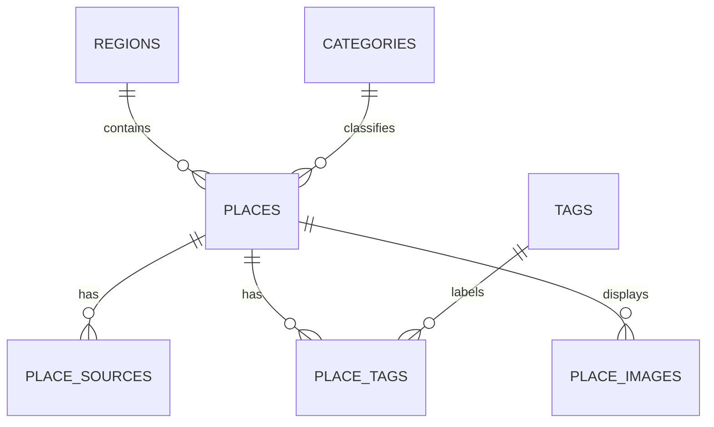

# 데이트 장소 탐색 서비스 DB 스키마

상태 · v0.5 검토용 초안  
관련 문서 · [PRD](PRD.md) · [API 명세](API.md)

TourAPI를 메인 장소의 외부 출처로 사용한다. PostgreSQL에는 허용 범위 내에서 수집한 기본정보와 서비스가 관리하는 분류를 저장하고, Express는 Prisma로 조회한다. 아래는 논리 모델과 제약 명세이며, 마이그레이션 구현 시 Prisma 모델과 SQL 제약을 함께 반영한다.

## 관계

## 테이블

표의 필드는 기본적으로 필수다. 선택 필드는 `NULL`을 허용한다. 시간 필드는 `timestamptz`로 저장하고 API에서는 UTC ISO 8601 문자열로 내보낸다.

| 테이블 | 필드 | 제약과 용도 |
| --- | --- | --- |
| `regions` | `id integer`, `slug text`, `name text`, `sort_order integer` | ID는 자동 증가 PK. slug는 UNIQUE. 예시 `seochon` → 서촌. |
| `categories` | `id integer`, `slug text`, `name text`, `sort_order integer` | ID는 자동 증가 PK. slug는 UNIQUE. 예시 `cafe` → 카페. |
| `tags` | `id integer`, `kind enum`, `slug text`, `name text`, `sort_order integer` | ID는 자동 증가 PK. `(kind, slug)` UNIQUE. kind는 `mood\|situation`. PRD의 분위기와 상황을 분리한다. |
| `places` | `id integer`, `region_id integer`, `category_id integer`, `name text`, `summary text?`, `overview text?`, `address text`, `latitude decimal(9,6)`, `longitude decimal(9,6)`, `setting enum?`, `status enum`, `kakao_map_url text?`, `naver_map_url text?`, `verified_at timestamptz?`, `created_at timestamptz`, `updated_at timestamptz` | ID는 자동 증가 PK. summary는 운영자 한줄 소개, overview는 TourAPI 소개다. setting이 비어 있으면 미분류다. setting은 `indoor\|outdoor\|mixed`. status는 `draft\|published\|hidden`이며 기본값은 `draft`. |
| `place_sources` | `place_id integer`, `provider text`, `external_id text`, `content_type_id text?`, `source_url text?`, `source_modified_at timestamptz?`, `last_synced_at timestamptz` | `place_id`는 FK. `(provider, external_id)`를 PK로 하고 `(place_id, provider)`를 UNIQUE로 둔다. TourAPI의 `contentid`를 external_id로 저장한다. |
| `place_tags` | `place_id integer`, `tag_id integer` | 복합 PK `(place_id, tag_id)`. 둘 다 FK. |
| `place_images` | `id integer`, `place_id integer`, `image_url text`, `alt_text text`, `sort_order integer`, `source_url text?`, `provider text?`, `license_code text?`, `usage_basis text`, `attribution_text text?` | ID는 자동 증가 PK. `(place_id, sort_order)` UNIQUE. 0부터 정렬하며 가장 작은 순서의 사진을 대표 사진으로 쓴다. |

- 장소에는 탐색 지역과 주 카테고리를 하나씩 지정하고 여러 분위기·상황 태그를 붙일 수 있다. 둘 다 해당하는 실내외 유형은 `mixed`로 관리한다. 사용자가 실내 또는 실외를 선택할 때는 각각 해당 값과 `mixed`를 포함한다.
- DB에서 위도 `-90..90`, 경도 `-180..180`, 사진 순서 0 이상을 CHECK한다. 공개 후보에서 장소명·주소·지역·카테고리·유효한 좌표를 검증한다. 검증된 지도 링크가 없으면 장소명과 좌표로 카카오맵 위치 링크를 만든다. `verified_at`은 운영 정보 확인을 기록할 때만 채운다. API는 좌표를 JSON 숫자로 직렬화한다.
- 장소의 지역·카테고리 FK 삭제는 `RESTRICT`한다. 장소를 실제 삭제하면 해당 출처 연결·태그 연결·이미지 행을 `CASCADE`한다. 태그 삭제 시 연결 행은 `CASCADE`한다. 운영 중에는 주소 변경·폐업 등 이력을 유지할 수 있도록 공개 상태 변경을 우선한다.
- 공개 API에서 목록·상세와 주변 검색의 중심은 `published` 장소만 사용한다. 주변 검색에는 상세 장소의 위도와 경도를 사용한다. 사진 행이 없으면 API는 대표 사진에 `null`을 내려주고 프론트에서 기본 이미지를 표시한다.
- 최근 조회는 같은 브라우저에서 최대 20개를 저장한다. DB와 서버 로그에 기능용 조회 이력을 기록하는 절차는 없으며, React는 성공한 상세에서 장소 ID와 조회 시점을 저장한다.

## 목록 조회와 인덱스

| 인덱스 | 지원 목적 |
| --- | --- |
| `places(status, created_at DESC, id DESC)` | 공개 목록 최근 등록순 |
| `places(region_id)`, `places(category_id)` | 지역·카테고리 FK와 필터 |
| `place_tags(tag_id, place_id)` | 태그 기준으로 장소 찾기 |

패턴 검색은 우선 장소명·지역명 부분 일치로 구현한다. 테스트 시드에서 실행 계획과 쿼리 시간을 확인해 병목이 드러날 때 검색 인덱스를 비교한다.

## TourAPI 수집과 동기화

1. 지역·카테고리·태그 코드를 준비한다. TourAPI 행정 구역 코드와 서비스 탐색 지역은 다를 수 있으므로, 주소·좌표를 사용해 내부 지역을 배정한다. 경계가 애매하면 검토 대상으로 둔다.
2. `(provider = tourapi, external_id = contentid)`로 장소를 찾는다. 신규 장소와 출처 매핑은 한 트랜잭션에서 생성하고, 재수집 시 같은 내부 ID를 유지한다. 이름이나 주소가 비슷하고 외부 ID가 다른 경우에는 중복 후보로 검토한다.
3. 기본정보와 성공한 동기화 시각만 갱신한다. 일부 요청 실패나 일시적으로 누락된 페이지를 삭제로 해석하지 않는다. 사진 이용 조건 확인에 실패하면 기존 노출 사진의 이용 근거를 별도로 확인하고 신규 사진은 보류한다. 신규 후보의 지역·카테고리는 수집 시 배정하고, 기존 장소의 지역·카테고리·실내외 분류, 한줄 소개, 태그와 공개 상태는 보존한다. 장소 좌표나 주소가 바뀌면 기존 검증 지도 링크의 유효성을 다시 확인한다.
4. 신규 후보는 `draft`로 시작한다. 이름·주소·좌표·카테고리가 유효하고 탐색 지역이 명확하며 중복 후보가 없으면 자동으로 `published`로 전환한다. 필수값 오류, 지역 배정 모호, 중복 의심이 있으면 `draft`를 유지한다. 필수값이나 필수 FK가 없어 장소 행을 만들 수 없는 후보는 수집 결과에 보류 사유를 남긴다. 자동 공개는 신규 후보에만 적용하며 기존 공개 상태는 동기화에서 보존한다. 사진과 태그가 미확인인 장소는 기본 이미지와 미분류로 처리할 수 있다.
5. 테스트용 합성 시드는 공개 장소 데이터와 분리한다. 카카오 로컬 주변 검색 결과는 현재 화면에서만 다루며 장소로 저장하지 않는다.
